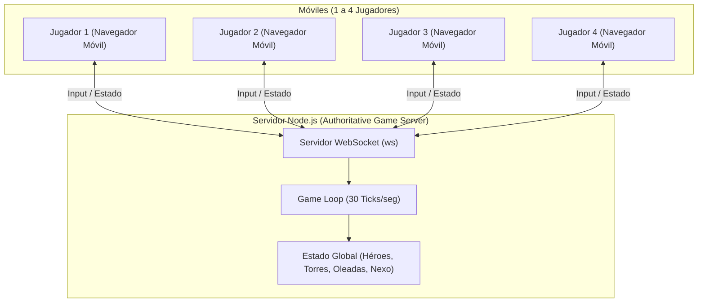

# Arquitectura y Diseño: Hero Base Defense (LoL + Clash of Clans)

## 1. Concepto Central
Un juego web cooperativo para hasta **4 jugadores** en tiempo real desde celulares (sin instalar apps).

- **Defensa de Base (Estilo Clash of Clans)**:
  - Un **Nexo/Ayuntamiento** central en el mapa con puntos de vida compartidos.
  - Los jugadores construyen y mejoran torretas (cañones, torres de arqueras), trampas y muros usando oro obtenido al derrotar oleadas.
- **Héroes y Combate (Estilo LoL)**:
  - Cada jugador controla un héroe con rol único (Guerrero, Mago, Tirador, Soporte).
  - Controles táctiles móviles: Joystick virtual para movimiento + 2 a 3 botones de habilidades y ataque básico.
  - Subida de nivel y desbloqueo de mejoras durante la partida.

---

## 2. Mecánicas Evolutivas y Modos de Partida
Para mantener el juego fresco entre partidas y que las reglas muten:
- **Mutadores de Partida (Modos dinámicos)**:
  - *Modo Clásico (Asedio)*: Oleadas progresivas y defensa del Nexo.
  - *Supervivencia Frenética*: Sin muros, velocidad duplicada y aparición masiva de monstruos.
  - *Caza de Jefes (Boss Rush)*: Jefes gigantescos con mecánicas de esquive tipo incursión.
- **Evolución tipo Roguelike (Cartas/Augments)**:
  - Al final de cada oleada o nivel, los jugadores eligen entre 3 mejoras aleatorias que alteran cómo funcionan sus habilidades o las torres (ej. proyectiles que rebotan, fuego en área, torretas congelantes).

---

## 2. Roles de los 4 Jugadores
1. **El Tanque / Coloso**: Mucha vida, control de masas (aturdir/ralentizar), protege las brechas del muro.
2. **El Mago de Área**: Daño explosivo en zona para limpiar hordas numerosas de súbditos.
3. **El Tirador / Francotirador**: Daño a distancia sostenido, ideal contra gigantes o jefes de oleada.
4. **El Ingeniero / Soporte**: Cura o repara estructuras, coloca trampas y potencia las torres.

---

## 3. Arquitectura Técnica

### Componentes:
- **Frontend Móvil**: HTML5 Canvas 2D + Touch Controls (joystick virtual y botones flotantes). Compatible 100% con Chrome/Safari móvil.
- **Backend (Node.js + WebSockets)**:
  - Gestiona el estado de la partida a 30 FPS.
  - Generación de oleadas (spawners tipo CoC que marchan hacia el nexo).
  - Detección de colisiones y daño en servidor para evitar desincronizaciones.
- **Conexión entre amigos**: Servidor HTTP local con soporte para túnel (o LAN/Wi-Fi común) con un código de sala simple (ej. `SALA-123`).
